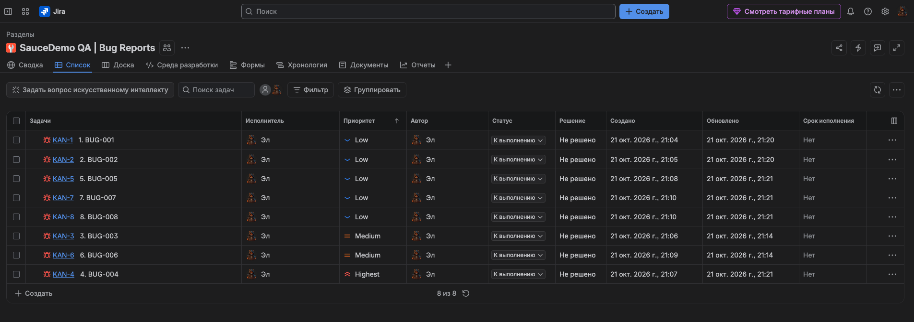

# Баг-репорты и тестовая документация (QA Portfolio)

## 📌 О проекте

Данный проект создан для практики ручного тестирования программного обеспечения (Manual QA)

В рамках проекта проводится функциональное тестирование учебного интернет-магазина SauceDemo, оформляются баг-репорты и подготавливается тестовая документация. Цель проекта — продемонстрировать базовые навыки начинающего QA-инженера

## 🎯 Цели проекта

- Практика ручного и исследовательского тестирования
- Проверка функциональности веб-приложения
- Выявление и документирование дефектов
- Составление понятных и воспроизводимых баг-репортов
- Определение серьёзности дефектов (Severity) и приоритета исправления (Priority)
- Документирование результатов тестирования
- Подготовка проекта для QA-портфолио на GitHub

## 🧪 Объект тестирования

- **Приложение:** SauceDemo
- **Ссылка:** [https://www.saucedemo.com/](https://www.saucedemo.com/)
- **Тип тестирования:** ручное функциональное тестирование, UI/UX, адаптивность
- **Инструменты:** браузер, Visual Studio Code, Markdown, Git, GitHub, Jira
- **Основные области проверки:** авторизация, каталог товаров, корзина, оформление заказа

## 🐞 Баг-репорты (Jira)

Все подтверждённые дефекты оформлены в баг-трекере Jira с соблюдением стандартов оформления 

🔗 **[Открыть доску проекта в Jira](https://50chin50.atlassian.net/jira/software/projects/KAN/list?jql=project%20%3D%20KAN%20ORDER%20BY%20priority%20ASC%2C%20cf%5B10019%5D%20ASC)**

### Скриншот доски в Jira



*Примечание: дефекты воспроизводились под учетной записью `visual_user`. Под `standard_user` данные дефекты отсутствуют, что подтверждает эталонное поведение интерфейса*

## 📂 Структура проекта

```text
bug-reports-jira-portfolio/
├── README.md
├── bug-reports/
│   ├── BUG-001 - 008.md
├── test-documentation/
│   ├── test-environment.md
│   └── test-summary.md
└── screenshots/
    └── screenshots-files
```

## 📄 Тестовая документация

В папке `test-documentation/` размещены следующие документы:

* `test-environment.md` — описание окружения, в котором проводилось тестирование (ОС, браузер, разрешения, тестовые данные)
* `test-summary.md` — сводка выполненных проверок, результатов и обнаруженных дефектов (итоговый отчет)

## 🛠 Используемые инструменты

* **SauceDemo** — учебное приложение для тестирования
* **Jira** — трекер задач для оформления баг-репортов
* **Visual Studio Code** — редактор для подготовки документации
* **Markdown** — формат оформления документов
* **Git и GitHub** — система контроля версий и публикация проекта

## 📊 Результаты тестирования

По результатам проверки каталога, корзины и страницы оформления заказа (Checkout) было обнаружено **8 дефектов**.

* **Critical:** 1 (Несоответствие цен между каталогом и корзиной)
* **Major:** 2 (Нарушение адаптивности на 480px, Смещение кнопки Checkout)
* **Minor:** 3 (Некорректные изображения, Смещение иконки корзины)
* **Trivial:** 2 (Кривой крестик меню, Смещение стрелки на кнопке Cancel)

Подробная сводка со списком всех багов доступна в файле [`test-summary.md`](/test-documentation/test-summary.md)

## 👩‍💻 Автор

Начинающий QA-инженер

Проект выполнен в учебных целях для развития навыков ручного тестирования и подготовки профессионального портфолио
