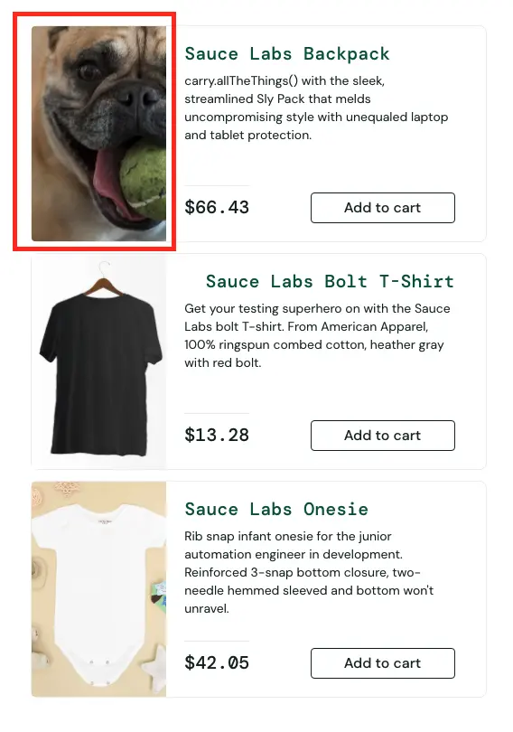
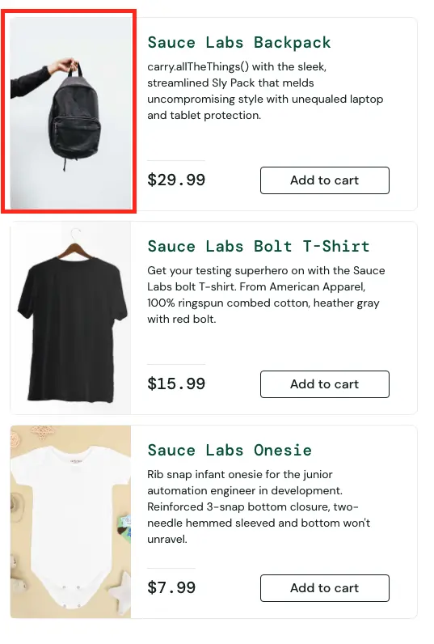

# BUG-001 — Неправильное изображение товара Sauce Labs Backpack

## Общая информация

- **ID:** BUG-001
- **Название:** Неправильное изображение товара Sauce Labs Backpack
- **Приложение:** SauceDemo
- **Раздел:** Каталог товаров (Inventory)
- **Тип дефекта:** Визуальный
- **Severity:** Minor
- **Priority:** Low
- **Статус:** Open

## Окружение

- **Тестовый сайт:** https://www.saucedemo.com/
- **Тестовый пользователь:** visual_user
- **Браузер:** Google Chrome
- **ОС:** macOS
- **Разрешение экрана:** 1920 × 1080 px

## Предусловия

Пользователь авторизован в SauceDemo под учётной записью `visual_user` и находится в каталоге товаров

## Шаги воспроизведения

1. Открыть https://www.saucedemo.com/
2. Войти с логином `visual_user` и паролем `secret_sauce`
3. Открыть каталог товаров
4. Найти товар Sauce Labs Backpack
5. Проверить изображение товара в карточке

## Ожидаемый результат

В карточке товара Sauce Labs Backpack отображается изображение рюкзака, соответствующее названию и описанию товара

## Фактический результат

Вместо изображения рюкзака отображается изображение собаки. Название и описание товара при этом корректны

## Воспроизводимость

Воспроизводится стабильно (3/3) под пользователем `visual_user`. Под пользователем `standard_user` изображение рюкзака отображается корректно

## Доказательства

### Пользователь visual_user — неправильное изображение

### Пользователь standard_user — правильное изображение

## Дополнительно

- **Связанные дефекты:** BUG-002
- **Примечание:** Дефект воспроизводится только под учётной записью `visual_user`. Под `standard_user` изображение товара корректное
