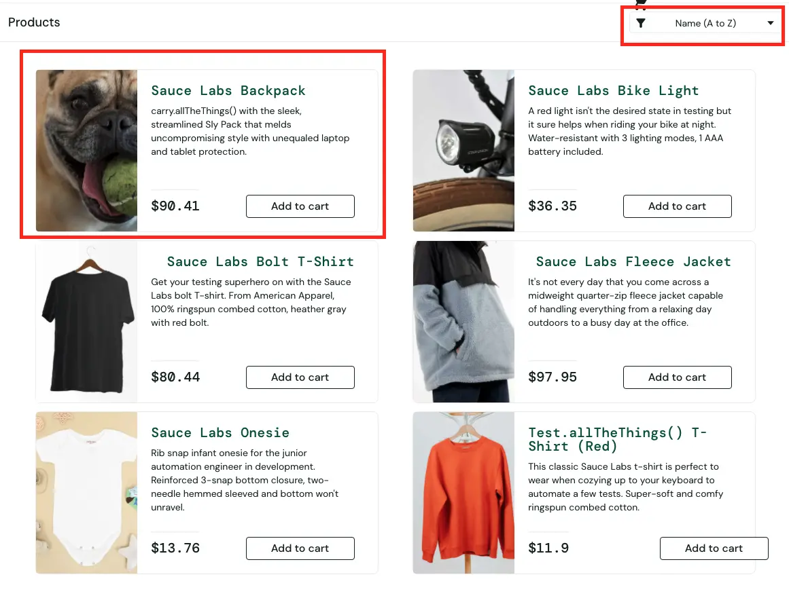
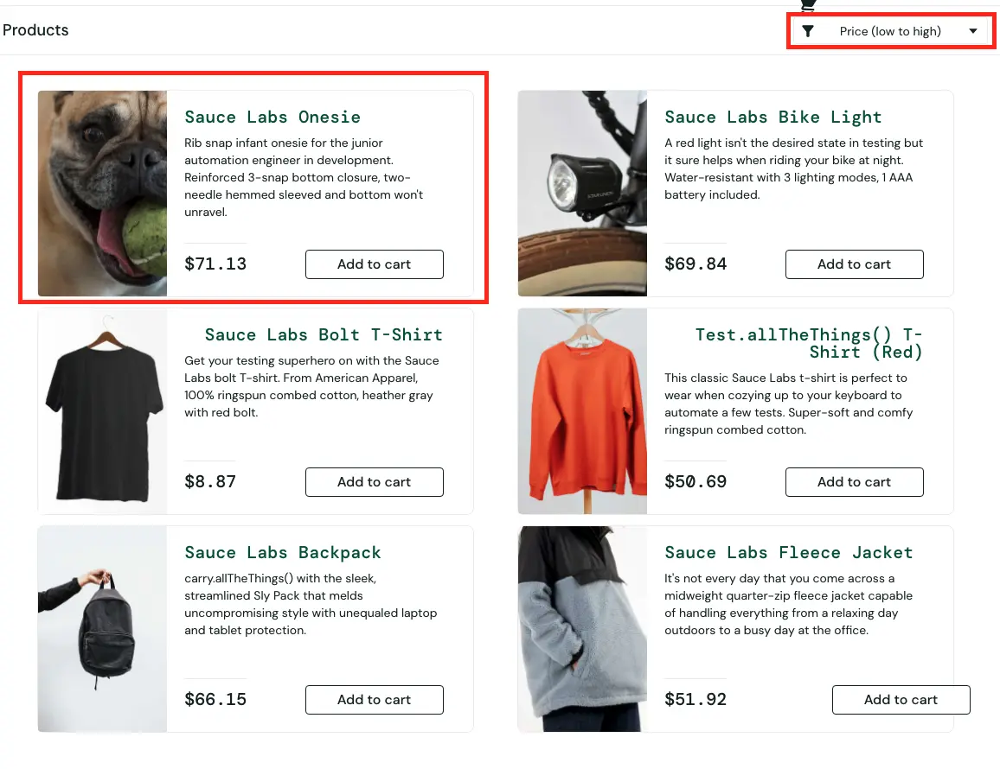

# BUG-002 — Изображение собаки остаётся в первой карточке при сортировке товаров

## Общая информация

- **ID:** BUG-002
- **Название:** Изображение собаки остаётся в первой карточке при сортировке товаров
- **Приложение:** SauceDemo
- **Раздел:** Каталог товаров (Inventory)
- **Тип дефекта:** Визуальный
- **Severity:** Minor
- **Priority:** Low
- **Статус:** Open

## Окружение

- **Тестовый сайт:** https://www.saucedemo.com/
- **Тестовый пользователь:** visual_user
- **Браузер:** Google Chrome
- **ОС:** macOS
- **Разрешение экрана:** 1920 × 1080 px

## Предусловия

Пользователь авторизован под учётной записью `visual_user` и находится в каталоге товаров.

## Шаги воспроизведения

1. Открыть https://www.saucedemo.com/
2. Войти с логином `visual_user` и паролем `secret_sauce`
3. Открыть каталог товаров
4. Проверить изображение в первой карточке (исходный порядок)
5. Выбрать сортировку **Name (Z to A)**
6. Проверить изображение и название товара в первой карточке
7. Повторить проверку с сортировками **Price (low to high)** и **Price (high to low)**

## Ожидаемый результат

Изображение в каждой карточке соответствует названию и описанию соответствующего товара после изменения сортировки

## Фактический результат

После изменения сортировки изображение собаки остаётся в первой карточке, тогда как название товара в этой карточке меняется

Наблюдаемое поведение:

| Сортировка            | Название в первой карточке | Изображение в первой карточке |
| ------------------------------- | ------------------------------------------------- | ------------------------------------------------------- |
| Исходный каталог | Sauce Labs Backpack                               | Собака (некорректно)                   |
| Name (Z to A)                   | Test.allTheThings() T-Shirt (Red)                 | Собака (некорректно)                   |
| Price (low to high)             | Sauce Labs Onesie                                 | Собака (некорректно)                   |
| Price (high to low)             | Sauce Labs Fleece Jacket                          | Собака (некорректно)                   |

## Воспроизводимость

Воспроизводится стабильно (3/3) под пользователем `visual_user`. Под пользователем `standard_user` изображения отображаются корректно при всех сортировках

## Доказательства

### Скриншот до сортировки

### Скриншот после сортировки

## Дополнительно

- **Связанные дефекты:** BUG-001 (Relates to)
- **Примечание:** Поведение наблюдается только под учётной записью `visual_user`. Требуется уточнить у разработчика: это самостоятельный дефект или следствие BUG-001
