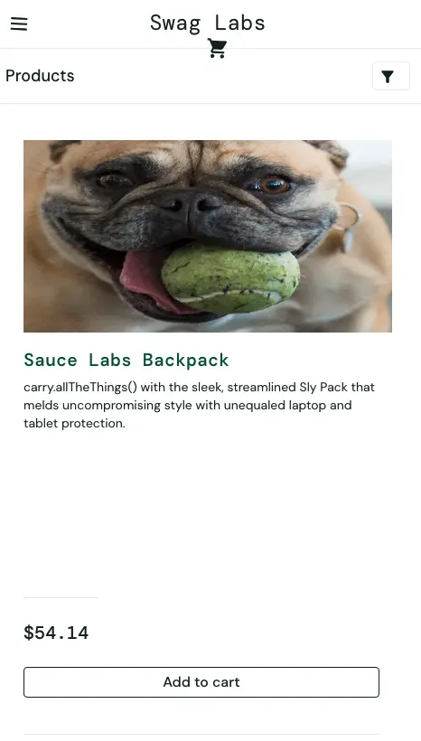
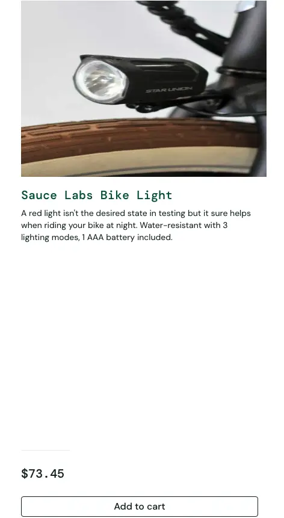

# BUG-003 — Нарушение вёрстки карточки товара при разрешении 480px (visual_user)

## Общая информация

- **ID:** BUG-003
- **Название:** Нарушение сетки и смещение цены/кнопки в карточке товара при мобильном разрешении
- **Приложение:** SauceDemo
- **Раздел:** Каталог товаров (Inventory) / Адаптивная вёрстка
- **Тип дефекта:** Визуальный / UI / Адаптивность
- **Severity:** Major
- **Priority:** Medium
- **Статус:** Open

## Окружение

- **Тестовый сайт:** https://www.saucedemo.com/
- **Тестовый пользователь:** visual_user
- **Браузер:** Google Chrome
- **Режим:** Device Toolbar (Responsive), ширина 480px
- **ОС:** macOS

## Предусловия

Пользователь авторизован под учётной записью `visual_user` и находится в каталоге товаров

## Шаги воспроизведения

1. Открыть https://www.saucedemo.com/
2. Войти с логином `visual_user` и паролем `secret_sauce`
3. Открыть каталог товаров
4. Открыть DevTools (F12) и включить режим адаптивности (Toggle device toolbar)
5. Установить ширину экрана 480px
6. Обратить внимание на карточки товаров

## Ожидаемый результат

Карточка товара сохраняет целостную структуру при мобильном разрешении: изображение, описание, цена и кнопка «Add to cart» расположены последовательно с адекватными отступами. Цена и кнопка находятся сразу под описанием товара

## Фактический результат

При ширине экрана 480px нарушается сетка карточки товара. Между текстовым описанием и ценой образуется огромное пустое пространство. Цена  и кнопка `Add to cart` смещены вниз за пределы логического блока, что делает карточку визуально нечитаемой и ломает пользовательский опыт

## Воспроизводимость

Воспроизводится стабильно (3/3) при заданной ширине экрана.

## Доказательства

## Дополнительно

- **Связанные дефекты:** BUG-001, BUG-002 (все относятся к проблемам отображения под visual_user).
- **Примечание:** Требуется сравнить с поведением под `standard_user` при том же разрешении для подтверждения эталонного поведения
