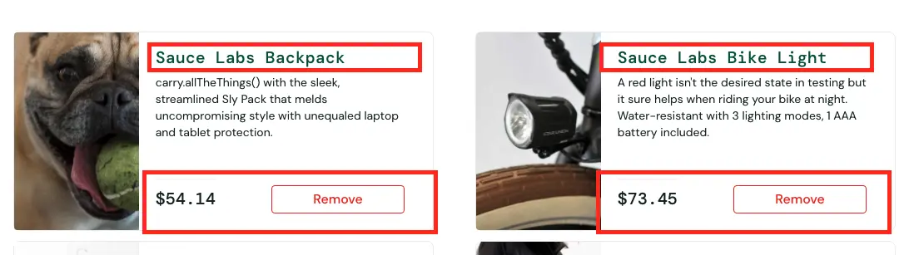
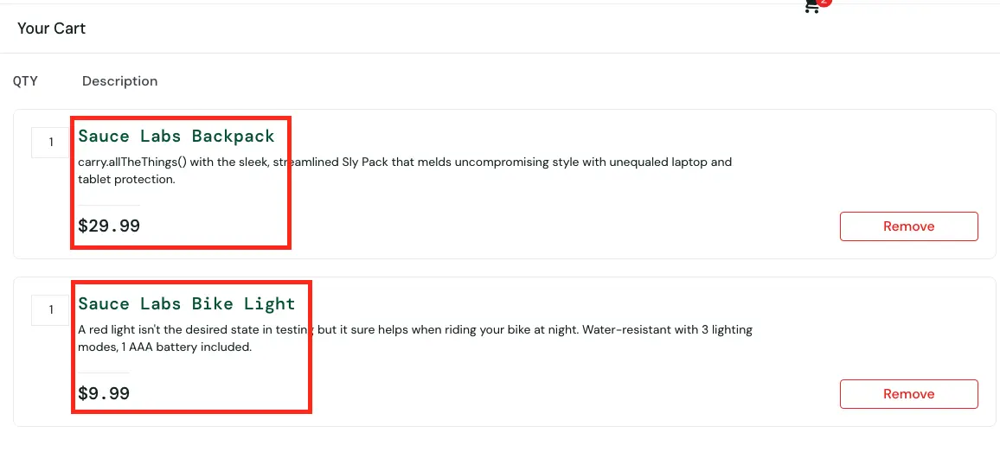

# BUG-004 — Цена товара в каталоге не совпадает с ценой в корзине

## Общая информация

- **ID:** BUG-004
- **Название:** Несоответствие цен на все товары между каталогом и корзиной
- **Приложение:** SauceDemo
- **Раздел:** Каталог товаров / Корзина
- **Тип дефекта:** Функциональный / Логический
- **Severity:** Critical
- **Priority:** High
- **Статус:** Open

## Окружение

- **Тестовый сайт:** https://www.saucedemo.com/
- **Тестовый пользователь:** visual_user
- **Браузер:** Google Chrome
- **ОС:** macOS
- **Разрешение экрана:** 1920 × 1080 px

## Предусловия

Пользователь авторизован под учётной записью `visual_user` и находится в каталоге товаров

## Шаги воспроизведения

1. Открыть https://www.saucedemo.com/
2. Войти с логином `visual_user` и паролем `secret_sauce`
3. В каталоге товаров запомнить цены любых двух товаров (например, Sauce Labs Backpack и Sauce Labs Bike Light)
4. Нажать кнопку `Add to cart` на карточках этих товаров
5. Нажать на иконку корзины в правом верхнем углу
6. Сравнить цены выбранных товаров в корзине с ценами в каталоге

## Ожидаемый результат

Цены **на всех товарах** в корзине полностью совпадают с ценами, указанными в каталоге товаров

## Фактический результат

Цены **на всех товарах** в каталоге отличаются от цен в корзине.
Примеры:

* Sauce Labs Backpack: в каталоге `$54.14`, в корзине `$29.99`
* Sauce Labs Bike Light: в каталоге `$73.45`, в корзине `$9.99`

При этом названия и описания товаров в корзине соответствуют каталогу, а кнопка `Add to cart` меняется на `Remove`

## Воспроизводимость

Воспроизводится стабильно (3/3)

## Доказательства

### Скриншот каталога с ценой

### Скриншот корзины с ценой

## Дополнительно

- **Примечание:** Под пользователем standard_user цены совпадают. Дефект воспроизводится только под visual_user. Требуется проверить, какая именно цена уходит на бэкенд при оформлении заказа (Checkout)
