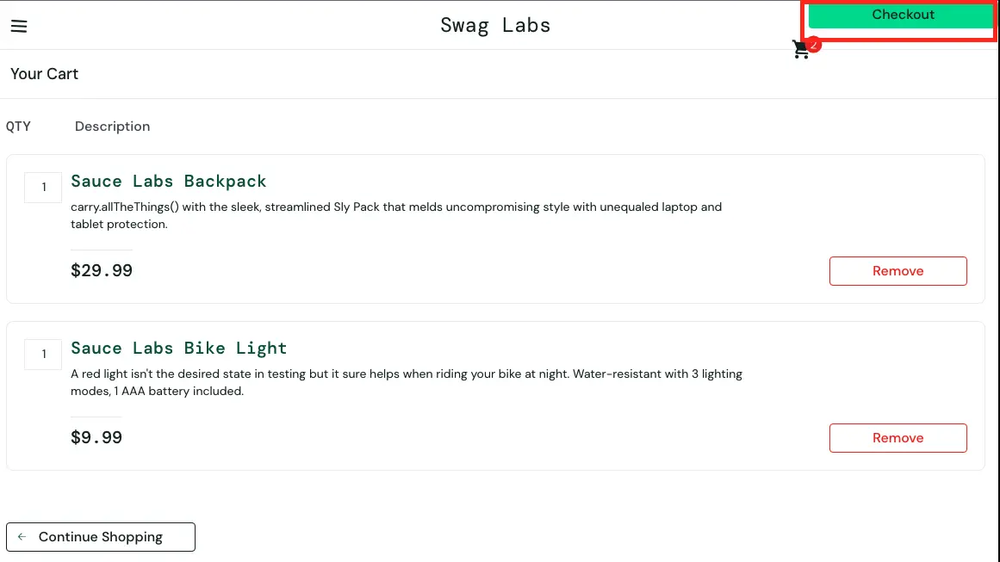

# BUG-006 — Кнопка Checkout выходит за пределы контейнера

## Общая информация

- **ID:** BUG-006
- **Название:** Кнопка Checkout съезжает к правому краю экрана и выходит за пределы своего блока
- **Приложение:** SauceDemo
- **Раздел:** Корзина (Cart)
- **Тип дефекта:** Визуальный / UI
- **Severity:** Major
- **Priority:** Medium
- **Статус:** Open

## Окружение

- **Тестовый сайт:** https://www.saucedemo.com/
- **Тестовый пользователь:** visual_user
- **Браузер:** Google Chrome
- **ОС:** macOS
- **Разрешение экрана:** 1920 × 1080 px

## Предусловия

Пользователь авторизован под учётной записью `visual_user`. В корзине находятся товары

## Шаги воспроизведения

1. Открыть https://www.saucedemo.com/
2. Войти с логином `visual_user` и паролем `secret_sauce`
3. Добавить любые два товара в корзину
4. Перейти на страницу корзины
5. Обратить внимание на кнопку `Checkout` в правой части экрана

## Ожидаемый результат

Кнопка `Checkout` находится внутри своего контейнера (блока с итоговой суммой) и имеет отступы от краев экрана

## Фактический результат

Кнопка `Checkout` выходит за пределы своего контейнера, прижимается к самому правому верхнему краю экрана и визуально «отрывается» от остального интерфейса корзины

## Воспроизводимость

Воспроизводится стабильно (3/3)

## Доказательства

## Дополнительно

- **Связанные дефекты:** BUG-005 (Смещение иконки корзины в шапке)
- **Примечание:** Под пользователем standard_user кнопка Checkout отображается корректно
