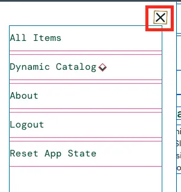

# BUG-007 — Некорректное отображение иконки закрытия бургер-меню

## Общая информация

- **ID:** BUG-007
- **Название:** Иконка закрытия меню (крестик) отображается под неправильным углом
- **Приложение:** SauceDemo
- **Раздел:** Навигационное меню (Burger menu)
- **Тип дефекта:** Визуальный / UI
- **Severity:** Trivial
- **Priority:** Low
- **Статус:** Open

## Окружение

- **Тестовый сайт:** https://www.saucedemo.com/
- **Тестовый пользователь:** visual_user
- **Браузер:** Google Chrome
- **ОС:** macOS
- **Разрешение экрана:** 1920 × 1080 px

## Предусловия

Пользователь авторизован под учётной записью `visual_user`

## Шаги воспроизведения

1. Открыть https://www.saucedemo.com/
2. Войти с логином `visual_user` и паролем `secret_sauce`
3. Нажать на иконку бургер-меню (три полоски) в левом верхнем углу
4. Обратить внимание на иконку закрытия меню (крестик)

## Ожидаемый результат

Иконка закрытия (крестик) отображается ровно, образуя симметричный угол 45 градусов

## Фактический результат

Иконка закрытия меню (крестик) визуально повернута на 2–5 градусов, из-за чего выглядит криво относительно горизонтали

## Воспроизводимость

Воспроизводится стабильно (3/3)

## Доказательства

## Дополнительно

- **Примечание:** Аналогичный дефект наблюдается у иконки открытия бургер-меню (три полоски имеют неровный наклон). Под пользователем standard_user иконки отображаются корректно
