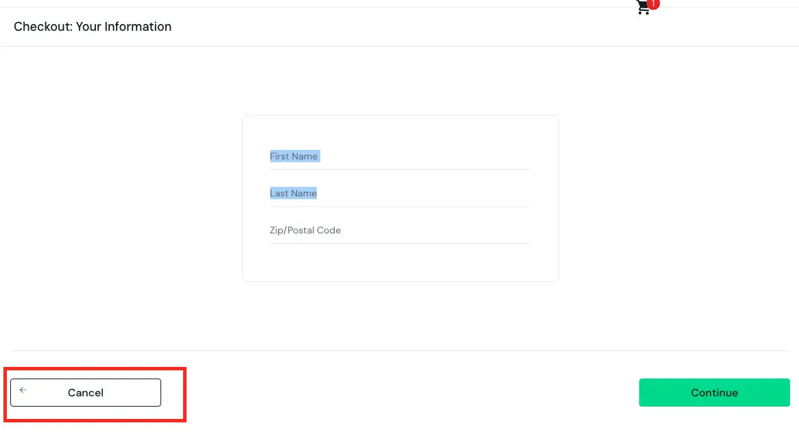

# BUG-008— Иконка стрелки на кнопке Cancel не выровнена по центру

## Общая информация

- **ID:** BUG-009
- **Название:** Иконка стрелки смещена вверх относительно текста на кнопке Cancel
- **Приложение:** SauceDemo
- **Раздел:** Оформление заказа (Checkout: Your Information)
- **Тип дефекта:** Визуальный / UI
- **Severity:** Trivial
- **Priority:** Low
- **Статус:** Open

## Окружение

- **Тестовый сайт:** https://www.saucedemo.com/
- **Тестовый пользователь:** visual_user
- **Браузер:** Google Chrome
- **ОС:** macOS
- **Разрешение экрана:** 1920 × 1080 px

## Предусловия

Пользователь авторизован под учётной записью `visual_user`. В корзине есть хотя бы один товар

## Шаги воспроизведения

1. Открыть https://www.saucedemo.com/
2. Войти с логином `visual_user` и паролем `secret_sauce`
3. Добавить любой товар в корзину
4. Перейти в корзину и нажать кнопку `Checkout`
5. Обратить внимание на кнопку `Cancel` в левой нижней части экрана

## Ожидаемый результат

Иконка стрелки и текст «Cancel» выровнены по одной горизонтальной оси (по центру кнопки)

## Фактический результат

Иконка стрелки на кнопке `Cancel` смещена вверх и не совпадает по уровню с текстом кнопки

## Воспроизводимость

Воспроизводится стабильно (3/3)

## Доказательства

## Дополнительно

- **Примечание:** Под пользователем standard_user выравнивание кнопки Cancel отображается корректно
